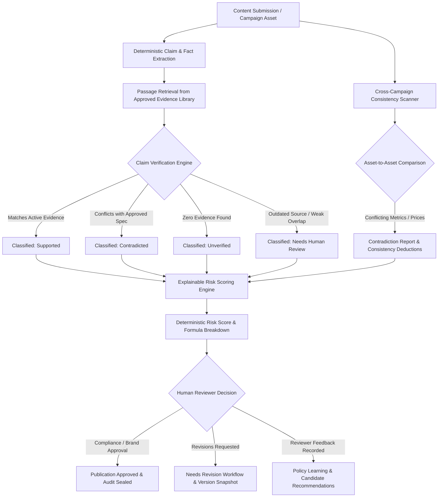

# Inkloom Guardian

> **AI-Powered Enterprise Brand Governance, Evidence-Backed Claim Verification & Risk Intelligence Platform**

[](https://nodejs.org/)
[](https://www.typescriptlang.org/)
[](https://react.dev/)
[](https://tailwindcss.com/)
[-purple.svg)](#8-database-free-architecture)
[](#14-automated-testing)
[](LICENSE)

---

## Table of Contents

1. [Project Overview](#1-project-overview)
2. [Problem Statement](#2-problem-statement)
3. [Key Features](#3-key-features)
4. [How It Works](#4-how-it-works)
5. [Technology Stack](#5-technology-stack)
6. [Project Architecture](#6-project-architecture)
7. [Database-Free Architecture](#7-database-free-architecture)
8. [Prerequisites](#8-prerequisites)
9. [Environment Variables](#9-environment-variables)
10. [Getting Started & Installation](#10-getting-started--installation)
11. [Running the Application](#11-running-the-application)
12. [Interactive Demo Mode (Judge Walkthrough)](#12-interactive-demo-mode-judge-walkthrough)
13. [API Endpoints Reference](#13-api-endpoints-reference)
14. [Automated Testing](#14-automated-testing)
15. [Security & Governance](#15-security--governance)
16. [Limitations & Future Enhancements](#16-limitations--future-enhancements)
17. [Contributing Guidelines](#17-contributing-guidelines)
18. [License & Ethical Disclaimer](#18-license--ethical-disclaimer)

---

## 1. Project Overview

**Inkloom Guardian** is an enterprise-grade AI brand governance platform designed to protect organizations from unverified claims, cross-channel inconsistencies, regulatory violations, and costly brand damage. 

The platform acts as an automated, evidence-grounded gatekeeper between marketing/content teams and public distribution channels. It cross-checks all statements against authorized source documents, cross-compares campaign assets for contradictory specifications or pricing, computes deterministic and explainable brand risk scores, and routes high-risk materials through a structured human-in-the-loop review workflow.

---

## 2. Problem Statement

Modern enterprises produce hundreds of marketing assets weekly—including advertisements, social media posts, press releases, data sheets, and partner collateral. In fast-paced marketing operations:

- **Unsubstantiated Claims:** Creators make numerical or superlative assertions (e.g., *"guarantees 99.9% uptime"*, *"100% emission reduction"*) without verifiable audit provenance.
- **Cross-Campaign Inconsistencies:** The billboard advertises \$499, the landing page says \$599, and social media quotes an expired promo date.
- **Black-Box AI Decisions:** Generic LLM checkers provide arbitrary "risk scores" without showing formula weights, citations, or distinguishing severity from confidence.
- **Workflow Friction & Audit Gaps:** Review teams lack granular version comparisons, immutable audit logs, and mechanisms to learn from recurring reviewer feedback without breaking official policy.

Inkloom Guardian solves these challenges through **deterministic evidence grounding, cross-asset consistency intelligence, transparent risk formulas, and audit-sealed human governance.**

---

## 3. Key Features

### 🔍 Evidence-Backed Claim Verification Engine
- Extracts factual, numerical, comparative, and promotional claims from content submissions.
- Chunks approved company evidence sources into traceable passages with page approximations and section headers.
- Classifies claims into four deterministic states:
  - **Supported:** Substantiated by verified active documentation with exact page and section citations.
  - **Contradicted:** Directly conflicts with approved metrics or ground truth data points.
  - **Unverified:** Novel assertion lacking any substantiating audit, policy, or legal documentation.
  - **Needs Human Review:** Weak lexical overlap or matches an outdated/superseded evidence source.
- Generates actionable, context-aware suggested corrections.

### 🌐 Cross-Campaign Consistency Intelligence
- Centralized Campaign Workspace managing multi-channel assets (text drafts, PDF press releases, social copy, ad creatives).
- Extracts structured entity facts: product names, tier pricing, technical specifications, warranty terms, and promotional validity windows.
- Filters out legitimate tier differences (e.g., Starter vs. Enterprise tier pricing) to eliminate false positives.
- Flags cross-asset discrepancies with exact snippet references, approved source of truth, severity classification, and itemized deductions.
- Computes a mathematical **Campaign Consistency Score** starting from 100 with itemized deductions.

### 📊 Explainable Deterministic Brand Risk Engine
- Deterministic scoring formula strictly bounded between 0 and 100.
- Categorizes findings into clear risk bands: **Minimal (0–19)**, **Low (20–39)**, **Moderate (40–59)**, **High (60–79)**, and **Critical (80–100)**.
- Separates finding **Severity** (Critical, High, Medium, Low) from detection **Confidence** (0.0 to 1.0).
- Applies verified domain multipliers: Legal/Regulatory (1.4x), Financial (1.3x), Safety (1.5x), Brand (1.0x).
- Deduplicates correlated findings to prevent artificial score inflation.
- Explicitly isolates **Unresolved Uncertainties** for missing evidence.
- *Strict Ethical Disclaimer:* Does not claim to empirically predict financial brand damage.

### 👥 Human-in-the-Loop Approval Workflow
- Formal lifecycle states: `draft` ➔ `analysis_pending` ➔ `analysis_complete` ➔ `needs_revision` ➔ `ready_for_review` ➔ `approved` / `rejected`.
- Strict Role-Based Access Control (RBAC): Content Creators are barred from self-approving high-risk assets; only Compliance Officers and Brand Directors can grant publication sign-off.
- Side-by-side **Version Comparison Snapshots** displaying risk reduction deltas (e.g., initial draft risk 88 ➔ remediated draft risk 12).
- Approval audit trail recording reviewer identity, timestamp, rationale, and mandatory justification notes for high-risk exceptions.

### 🧠 Policy Learning from Reviewer Feedback
- Captures reviewer decisions (accepted corrections, rejected suggestions, documented exceptions).
- Computes empirical violation frequencies and recommendation acceptance rates.
- Suggests candidate guideline updates without automatically altering official brand policies.
- Protects confidential customer content via explicit retention policies and automated privacy scrubbing.
- Authorizes administrators to inspect, edit, or purge feedback records.

### ⚡ Interactive Demo Mode (VOLTERRA EV Battery Scenario)
- Realistic fictional brand scenario (**VOLTERRA**) promoting next-generation electric vehicle batteries.
- 1-click persona switching tokens for **Compliance Officer**, **Brand Director**, **Content Creator**, and **System Administrator**.
- Preloaded ground truth specification sheet (1,200 cycles approved) and certified price list (\$5,800).
- 3 deliberate multi-channel campaign assets containing conflicting specifications (1,800 cycles vs 1,200 cycles) and conflicting prices (\$5,800 vs \$6,200 vs \$7,400).
- 12-step guided judge tour through the complete verification, consistency scan, risk triage, and approval workflow.
- Sandboxed zero-impact demo reset that preserves multi-tenant data integrity.

---

## 4. How It Works



1. **Ingest Content:** Content creators submit plain text copy, campaign briefs, or multi-asset bundles.
2. **Deterministic Extraction:** System identifies numerical, factual, and promotional statements, extracting normalized metrics (currencies, cycles, dates, percentages).
3. **Passage Grounding:** Retrieves candidate passages from approved corporate evidence sources using structured lexical and keyword matching.
4. **Classification & Verification:** Compares assertions against retrieved evidence, tagging citations with document version, page number, and section header.
5. **Cross-Asset Consistency Scan:** In campaign mode, all assets are cross-checked against each other and the approved library to identify pricing discrepancies, spec mismatches, and expired promo dates.
6. **Risk Computation:** Applies the weighted deterministic formula across all findings, factoring in domain criticality and evidence weighting.
7. **Human Approval Gate:** Routes content to authorized reviewers. If changes are made, side-by-side snapshots illustrate the exact risk reduction.
8. **Feedback Ingestion:** Reviewer corrections are anonymously aggregated to identify recurring policy bottlenecks.

---

## 5. Technology Stack

| Layer | Technologies |
|---|---|
| **Frontend UI** | React 18, TypeScript, Vite, Tailwind CSS, Lucide React Icons, React Router DOM |
| **Backend API** | Node.js (v18–v22), Express 4, TypeScript (ESM modules), Helmet (CSP headers), CORS, Express Rate Limit, Multer, Zod, UUID |
| **Authentication & Security** | JSON Web Tokens (JWT), Bcryptjs password hashing, Role-Based Access Control (RBAC), Helmet security headers |
| **Data Engine** | **Database-Free In-Memory Query Engine (`InMemoryDatabase`)** with full SQL dialect compatibility and automatic demonstration seed provisioning |
| **AI / Intelligence Engine** | Pluggable architecture: Built-in Enterprise Heuristic & Deterministic Rule Intelligence Engine; optional adapters for Google Gemini, OpenAI, and Anthropic Claude |
| **Testing** | Node.js / tsx automated test runners with 134 unit and integration tests |

---

## 6. Project Architecture


---

## 7. Database-Free Architecture

Inkloom Guardian is engineered with a **pure TypeScript in-memory query engine (`InMemoryDatabase`)**, eliminating any dependency on external database servers such as PostgreSQL, MySQL, or cloud datastores.

### Why Database-Free?
- **Zero Configuration for Evaluators & Judges:** No need to install PostgreSQL, configure connection strings, start Docker daemons, or troubleshoot port conflicts.
- **Instant Boot:** Starts up in under 500 milliseconds.
- **Portability:** Runs identically across macOS, Windows, and Linux environments.
- **100% Contract Compatibility:** The `InMemoryDatabase` exposes the standard `db.query<T>(sql, params)` interface, supporting:
  - Parameterized bindings (`$1`, `$2`, ...)
  - `INSERT` with `ON CONFLICT DO UPDATE / DO NOTHING` and `RETURNING *`
  - `UPDATE` with `COALESCE` and `RETURNING`
  - `DELETE` with nested subquery filtering
  - `SELECT` with `INNER / LEFT JOIN`, multi-condition `WHERE`, `GROUP BY`, `ORDER BY`, `LIMIT`, `OFFSET`, subqueries, and aggregate functions (`COUNT(*)`, `SUM(CASE ...)`, `AVG`)
- **Persistence & Seeding Behavior:** On server boot, the system verifies all 20 in-memory tables and automatically provisions comprehensive enterprise demonstration data. *Note: Data lives in memory during the server process lifecycle and returns to the clean baseline state upon server restart or via the 1-click Reset Demo button.*

---

## 8. Prerequisites

- **Node.js:** `v18.0.0` or higher (`v20.x` or `v22.x` recommended).
- **npm:** `v9.0.0` or higher.
- **Git**

Verify your environment:
```bash
node -v
npm -v
git --version
```

---

## 9. Environment Variables

Create a `server/.env` file based on the provided `server/.env.example`. Because Inkloom Guardian operates database-free, **no database connection strings are required.**

```env
# Server Configuration
PORT=5000
NODE_ENV=development

# Authentication Security (Change in production)
JWT_SECRET=inkloom_jwt_super_secure_enterprise_secret_key_2026_change_in_production
JWT_EXPIRES_IN=7d

# LLM / AI Engine Configuration
# Available Providers: 'mock', 'gemini', 'openai', 'anthropic'
# Default 'mock' utilizes the built-in deterministic heuristic rule engine
LLM_PROVIDER=mock
GEMINI_API_KEY=
OPENAI_API_KEY=
ANTHROPIC_API_KEY=
LLM_MODEL=default

# Upload Configuration
MAX_UPLOAD_SIZE_MB=15
UPLOAD_DIR=./uploads
```

---

## 10. Getting Started & Installation

### Step 1: Clone the Repository
```bash
git clone https://github.com/prateek9126/Inkloom-Guardian.git
cd Inkloom-Guardian
```

### Step 2: Install Dependencies
The project uses npm workspaces to manage client and server dependencies simultaneously:
```bash
npm install
```

### Step 3: Configure Environment
Copy the example environment configuration into the server folder:
```bash
# On Linux/macOS
cp server/.env.example server/.env

# On Windows (PowerShell)
Copy-Item server/.env.example server/.env
```

---

## 11. Running the Application

### Full-Stack Development Mode (Recommended)
Runs both the Express backend (Port 5000) and the Vite frontend (Port 5173) concurrently:
```bash
npm run dev
```
Open your browser at **[http://localhost:5173](http://localhost:5173)**.

### Running Backend or Frontend Individually
```bash
# Start backend only
npm run dev:server

# Start frontend only
npm run dev:client
```

### Production Build & Launch
```bash
# Compile both client and server packages
npm run build

# Start the compiled production server
npm run start
```
The production server serves both the REST API and the compiled static frontend on **http://localhost:5000**.

---

## 12. Interactive Demo Mode (Judge Walkthrough)

Inkloom Guardian includes a **Hackathon Judge Demo Mode** designed for instant evaluation without manual data entry.

### Preloaded Scenario: VOLTERRA Electric Vehicle Batteries
- **Organization:** VOLTERRA Energy Technologies (EV Battery Manufacturing)
- **Approved Evidence:**
  - *Engineering Spec Sheet (v3.2):* Officially certifies **1,200 charge cycles** at 80% capacity retention.
  - *Master Price Catalog:* Officially lists base unit price at **\$5,800**.
  - *Safety Certification (ISO-26262):* Certified thermal runaway threshold at 165°C.
- **Deliberate Campaign Inconsistencies:**
  1. *Billboard Ad:* Claims 1,800 cycles (+50% exaggerated spec) and lists price at \$5,800.
  2. *Social Media Creative:* Quotes discounted price of \$6,200 (+7% discrepancy) and an expired promo date.
  3. *Press Release:* Quotes commercial fleet price of \$7,400.

### 1-Click Persona Switcher
Switch roles instantly from the top navigation bar without logging out:
- **Compliance Officer** (`compliance@volterra.demo`) – Full governance authority, revision requests, exceptions sign-off.
- **Brand Director** (`brand@volterra.demo`) – Brand guideline management, final marketing approval.
- **Content Creator** (`creator@volterra.demo`) – Submits content, runs scans; restricted from self-approving high-risk assets.
- **Administrator** (`admin@volterra.demo`) – Audit log oversight, tenant settings, feedback retention purging.

### 12-Step Guided Tour Sequence
Click **"Explore Demo"** or **"Start Guided Tour"** in the UI to walk through the complete enterprise governance lifecycle:
1. Initialize Volterra workspace.
2. Inspect approved ground truth evidence and passage chunking.
3. Review brand guidelines and banned terminology.
4. View submitted campaign assets (Billboard, Social, Press Release).
5. Execute Claim Verification Scan (observe Supported vs Contradicted classifications).
6. Inspect Evidence Graph node links and passage citations.
7. Run Cross-Campaign Consistency Intelligence Scan (detect spec and pricing conflicts).
8. Examine Explainable Risk Breakdown and deterministic formula weights.
9. Inspect Side-by-Side Version Snapshot (v1 draft risk 88 ➔ v2 remediated risk 12).
10. Switch to Compliance Officer persona and review justification requirements.
11. Grant publication sign-off and seal the immutable audit trail.
12. Review Policy Learning recommendations generated from reviewer actions.

*Resetting the Demo:* Click **"Reset Demo Data"** at any time to restore the demonstration state.

---

## 13. API Endpoints Reference

### Authentication (`/api/auth`)
| Method | Endpoint | Description |
|---|---|---|
| `POST` | `/api/auth/register` | Register a new user and organization |
| `POST` | `/api/auth/login` | Authenticate user and receive JWT token |
| `GET` | `/api/auth/me` | Fetch authenticated user profile and permissions |

### Claim Verification (`/api/claims-verification`)
| Method | Endpoint | Description |
|---|---|---|
| `POST` | `/api/claims-verification/verify/:contentId` | Run verification scan on a content submission |
| `GET` | `/api/claims-verification/graph/:contentId` | Retrieve interactive Evidence Graph nodes and edges |
| `PATCH` | `/api/claims-verification/claims/:claimId/review` | Record human review action (confirm, reject, amend) |

### Campaign Consistency (`/api/campaigns-consistency`)
| Method | Endpoint | Description |
|---|---|---|
| `POST` | `/api/campaigns-consistency/scan/:campaignId` | Execute cross-asset consistency intelligence scan |
| `GET` | `/api/campaigns-consistency/report/:campaignId` | Fetch contradiction report and itemized score deductions |
| `POST` | `/api/campaigns-consistency/contradictions/:id/action` | Record resolution action on a detected discrepancy |

### Risk Assessment & Review Workflow (`/api/risk`, `/api/reviews`)
| Method | Endpoint | Description |
|---|---|---|
| `POST` | `/api/risk/evaluate/:contentId` | Calculate explainable risk score and formula breakdown |
| `GET` | `/api/risk/report/:contentId` | Retrieve full risk analysis report with uncertainties |
| `GET` | `/api/risk/versions/:contentId/compare` | Compare risk scores and remediation across version snapshots |
| `POST` | `/api/reviews/submit` | Transition asset lifecycle state (request revision, approve, reject) |
| `GET` | `/api/reviews/history/:contentId` | Fetch complete approval and decision audit history |

### Evidence & Policy Learning (`/api/evidence`, `/api/policy-learning`)
| Method | Endpoint | Description |
|---|---|---|
| `GET` | `/api/evidence/sources` | List approved evidence source documents |
| `POST` | `/api/evidence/upload` | Upload and chunk new evidence source document |
| `GET` | `/api/policy-learning/rules/frequent` | List frequently violated rules and acceptance rates |
| `GET` | `/api/policy-learning/recommendations` | View policy candidate recommendations |
| `POST` | `/api/policy-learning/recommendations/:id/approve` | Admin approval of candidate guideline version |
| `DELETE` | `/api/policy-learning/feedback/:id/purge` | GDPR / compliance retention purge of feedback record |

### Demonstration Engine (`/api/demo`)
| Method | Endpoint | Description |
|---|---|---|
| `GET` | `/api/demo/status` | Check Volterra demo workspace status |
| `POST` | `/api/demo/initialize` | Seed or reset Volterra demonstration scenario |
| `POST` | `/api/demo/switch-persona` | Generate instant authenticated JWT token for demo role |
| `GET` | `/api/demo/walkthrough` | Retrieve 12-step guided judge tour sequence |

---

## 14. Automated Testing

Inkloom Guardian includes a comprehensive automated test suite covering all engines, mathematical formulas, role permissions, and tenant isolation guards.

### Running All Test Suites
```bash
# 1. Claim Verification Engine Test Suite
npx tsx server/src/tests/claimVerification.test.ts

# 2. Cross-Campaign Consistency Test Suite
npx tsx server/src/tests/campaignConsistency.test.ts

# 3. Explainable Risk & Review Workflow Test Suite
npx tsx server/src/tests/riskAssessmentWorkflow.test.ts

# 4. Policy Learning & Security Hardening Test Suite
npx tsx server/src/tests/policyLearningSecurity.test.ts

# 5. Interactive Demo Mode Test Suite
npx tsx server/src/tests/demoMode.test.ts
```

### Test Suite Summary

| Test Suite | Tests | Status | Verification Focus |
|---|:---:|:---:|---|
| **Claim Verification** | 23 | ✅ Passing | Multi-type claim extraction, Supported/Contradicted/Unverified classifications, outdated source detection, evidence graph links |
| **Campaign Consistency** | 33 | ✅ Passing | Structured fact extraction, legitimate tier filtering, cross-asset price/spec contradictions, score deduction formulas |
| **Risk & Workflow** | 33 | ✅ Passing | Deterministic risk formulas, domain multipliers, correlated finding deduplication, RBAC approval barriers, version snapshots |
| **Policy Learning & Security** | 7 | ✅ Passing | Reviewer preference recording, human-in-the-loop candidate recommendations, guideline versioning, data retention purging |
| **Demo Mode** | 38 | ✅ Passing | VOLTERRA provisioning, 1-click persona token generation, multi-asset deliberate conflicts, 12-step tour, sandbox reset |
| **Total Automated Tests** | **134** | **100%** | **134 Tests Passing with Zero Failures** |

---

## 15. Security & Governance

- **Authentication:** Stateless authentication using cryptographically signed JSON Web Tokens (JWT) with configurable expiration.
- **Password Protection:** User passwords hashed using Bcryptjs with salt work factor of 10.
- **Role-Based Access Control (RBAC):** Strict permissions matrix enforcing separation of duties between `content_creator`, `brand_manager`, `compliance_officer`, and `admin`. Content creators cannot self-approve assets.
- **Security Headers:** Comprehensive HTTP header protection via **Helmet**, including a strict Content Security Policy (CSP), frameguard, and cross-origin resource policies.
- **Rate Limiting:** Double-layered rate limiting (`express-rate-limit`):
  - General API Limiter: 500 requests per 15-minute window per IP.
  - Sensitive Auth Limiter: 30 authentication attempts per 15-minute window per IP.
- **Tenant Isolation:** All queries enforce strict tenant scoping via `org_id` parameters, ensuring multi-tenant data confidentiality.
- **Audit Trails:** Immutable audit logging records all administrative actions, lifecycle state transitions, reviewer comments, and policy updates.

---

## 16. Limitations & Future Enhancements

### Current Design Boundaries
- **Ephemeral In-Memory Runtime:** Because the engine operates database-free in memory, restart of the server process restores the preloaded baseline demonstration data. Production enterprise deployments requiring persistent disk storage across restarts can plug into external storage adapters or periodic JSON disk snapshots.
- **Pluggable AI Provider Default:** By default, the system runs on the built-in deterministic rule intelligence engine (`LLM_PROVIDER=mock`), which executes deterministic verification without external API keys. Setting `LLM_PROVIDER=gemini` or `openai` enables external LLM inference.
- **OCR Limitations:** Image and poster ingestion currently leverages server-side text extraction heuristics; integration with specialized cloud Vision APIs (Google Cloud Vision, AWS Textract) is recommended for complex scanned PDFs.

### Future Roadmap
- [ ] Integration of pgvector / HNSW vector embeddings for semantic passage retrieval at million-document scale.
- [ ] Automated Slack / Microsoft Teams webhooks for pending compliance review alerts.
- [ ] Multi-lingual brand guideline translation and international disclaimer verification.

---

## 17. Contributing Guidelines

Contributions to Inkloom Guardian are welcome! Please follow these steps:
1. Fork the repository.
2. Create your feature branch (`git checkout -b feature/amazing-feature`).
3. Ensure all tests pass (`npx tsx server/src/tests/claimVerification.test.ts`, etc.).
4. Commit your changes (`git commit -m 'feat: add amazing feature'`).
5. Push to your branch (`git push origin feature/amazing-feature`).
6. Open a Pull Request.

---

## 18. License & Ethical Disclaimer

### License
This project is licensed under the **MIT License** - see the [LICENSE](LICENSE) file for details.

### Ethical & Regulatory Disclaimer
Inkloom Guardian calculates deterministic risk scores based on heuristic weights, policy guidelines, and evidence document comparisons. **A risk score of 100 or any other calculated value is an indicator of detected policy/factual discrepancies and does not represent an empirical guarantee or scientifically validated prediction of actual financial or reputational brand damage.** Organizations must always employ qualified legal and regulatory counsel for final publication compliance.
