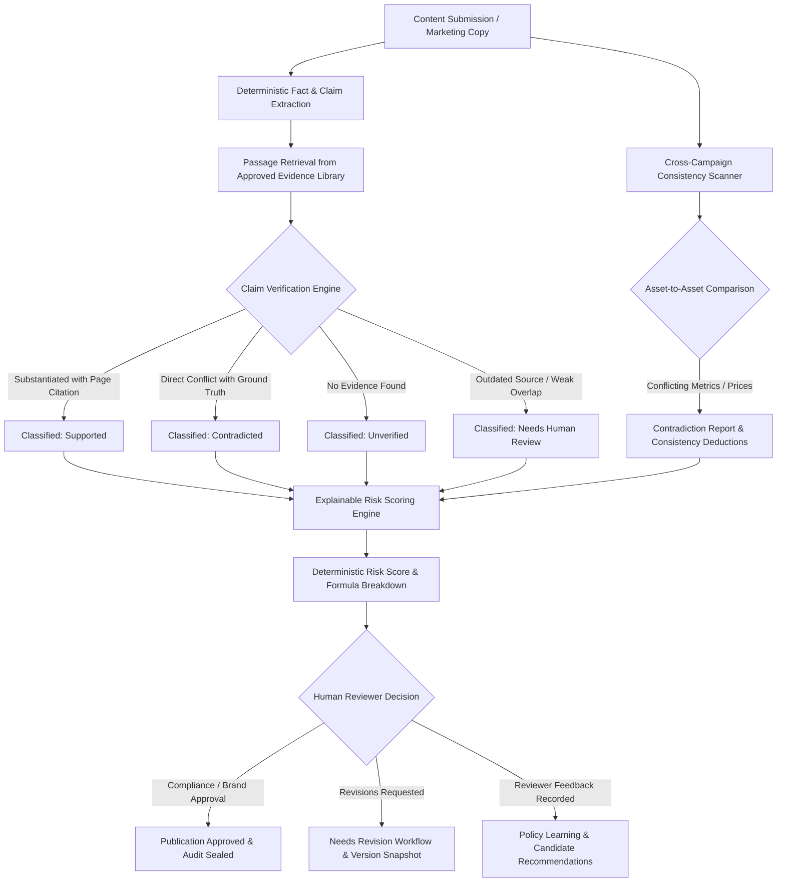
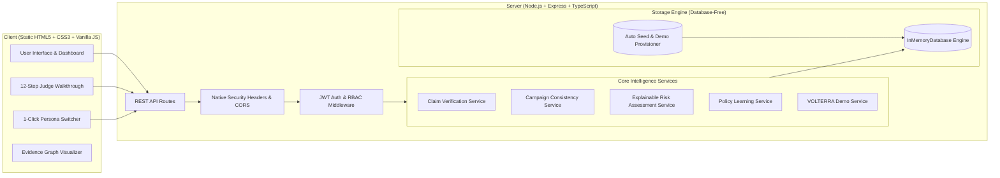

# Inkloom Guardian

> **Enterprise Brand Governance, Evidence-Backed Claim Verification & Risk Intelligence Platform**

[](https://nodejs.org/)
[-blue.svg)](https://www.typescriptlang.org/)
[](#5-technology-stack)
[-38bdf8.svg)](https://tailwindcss.com/)
[-purple.svg)](#7-database-free-architecture)
[](#14-automated-testing)
[](LICENSE)

---

## Table of Contents

1. [Project Overview](#1-project-overview)
2. [Problem Statement](#2-problem-statement)
3. [Key Features](#3-key-features)
4. [How It Works](#4-how-it-works)
5. [Technology Stack](#5-technology-stack)
6. [Project Architecture](#6-project-architecture)
7. [Database-Free Architecture](#7-database-free-architecture)
8. [Prerequisites](#8-prerequisites)
9. [Environment Variables](#9-environment-variables)
10. [Getting Started & Installation](#10-getting-started--installation)
11. [Running the Application](#11-running-the-application)
12. [Interactive Demo Mode (Judge Walkthrough)](#12-interactive-demo-mode-judge-walkthrough)
13. [API Endpoints Reference](#13-api-endpoints-reference)
14. [Automated Testing](#14-automated-testing)
15. [Security & Governance](#15-security--governance)
16. [Deployment Guide](#16-deployment-guide)
17. [Limitations & Future Enhancements](#17-limitations--future-enhancements)
18. [License & Ethical Disclaimer](#18-license--ethical-disclaimer)

---

## 1. Project Overview

**Inkloom Guardian** is an enterprise-grade brand governance platform designed to protect organizations from unverified claims, cross-channel campaign contradictions, regulatory violations, and costly brand damage. 

The platform acts as an automated, evidence-grounded gatekeeper between marketing/content teams and public distribution channels. It cross-checks all assertions against authorized source documents, cross-compares campaign assets for contradictory specifications or pricing, computes deterministic and explainable brand risk scores, and routes high-risk materials through a structured human-in-the-loop review workflow.

The project features a **pure static HTML5, CSS3, and Vanilla JavaScript frontend** (requiring zero frontend compilation or build step) paired with a high-performance **Node.js + Express backend** running on an in-memory database engine.

---

## 2. Problem Statement

Modern enterprises produce hundreds of marketing assets weekly—including advertisements, social media posts, press releases, data sheets, and partner collateral. In fast-paced marketing operations:

- **Unsubstantiated Claims:** Creators make numerical or superlative assertions (e.g., *"guarantees 99.9% uptime"*, *"100% emission reduction"*) without verifiable audit provenance.
- **Cross-Campaign Inconsistencies:** The billboard advertises \$499, the landing page says \$599, and social media quotes an expired promo date.
- **Black-Box AI Decisions:** Generic LLM checkers provide arbitrary "risk scores" without showing formula weights, citations, or distinguishing severity from confidence.
- **Workflow Friction & Audit Gaps:** Review teams lack granular version comparisons, immutable audit logs, and mechanisms to learn from recurring reviewer feedback without breaking official policy.

Inkloom Guardian solves these challenges through **deterministic evidence grounding, cross-asset consistency intelligence, transparent risk formulas, and audit-sealed human governance.**

---

## 3. Key Features

### 🔍 Evidence-Backed Claim Verification Engine
- Extracts factual, numerical, comparative, and promotional claims from content submissions.
- Chunks approved company evidence sources into traceable passages with page approximations and section headers.
- Classifies claims into four deterministic states:
  - **Supported:** Substantiated by verified active documentation with exact page and section citations.
  - **Contradicted:** Directly conflicts with approved metrics or ground truth data points.
  - **Unverified:** Novel assertion lacking any substantiating audit, policy, or legal documentation.
  - **Needs Human Review:** Matches an outdated/superseded evidence source.
- Generates actionable, context-aware suggested corrections with 1-click text application.

### 📊 Traceable Evidence Provenance Graph
- Models claims, evidence passages, primary source documents, brand rules, and review actions as an interconnected graph.
- Interactive multi-column hierarchy allows reviewers to trace any claim back to its exact page and paragraph in certified PDFs or spec sheets.

### 🔄 Cross-Campaign Consistency Intelligence
- Cross-asset comparison across advertising, social media, landing pages, and press releases.
- Automatically detects:
  - Conflicting prices for the same product tier or promotional offer.
  - Contradictory performance metrics and technical specifications (e.g., 18 hrs vs 30 hrs battery life).
  - Expired promotional offer dates.
  - Missing mandatory regulatory disclaimers.
- Computes a transparent **Campaign Consistency Score (0–100)** with clear itemized point deductions.

### 🛡️ Explainable Brand Risk Assessment Engine
- Deterministic formula strictly bounded between 0 and 100 with clear risk categories (Low, Medium, High, Critical).
- Separates severity from confidence (does not blend or confuse them).
- Applies domain criticality multipliers (Legal/Regulatory: 1.4x, Financial: 1.2x, Tone: 0.9x).
- Deduplicates correlated findings to prevent double-counting penalties.
- Highlights unresolved uncertainties and provides actionable remediation guidance.
- Non-arbitrary disclaimer: clearly states that a score of 100 represents an itemized governance metric, not a scientific damage probability.

### 👤 Human Approval Workflow & Version Snapshots
- Formal lifecycle states: `Draft` → `Analysis Pending` → `Analysis Complete` → `Needs Revision` → `Ready for Review` → `Approved` or `Rejected`.
- Role-Based Access Control (RBAC) enforcing separation of duties (content creators cannot self-approve).
- Mandatory written justification notes required for high-risk overrides.
- Visual revision comparison snapshots demonstrating quantitative risk reduction (e.g., from 88 to 12).

### 💡 Policy Learning from Reviewer Feedback
- Passively records reviewer decisions, accepted corrections, and justified exceptions.
- Highlights frequently violated rules and measures recommendation acceptance rates.
- Suggests candidate guideline updates requiring explicit authorized administrator sign-off.
- Maintains an explicit legal distinction between observed reviewer preferences and certified factual evidence.
- Compliant with enterprise privacy: zero customer content is used for third-party model training.

### ⚡ Interactive Demo Mode for Hackathon Judges
- Preloaded **VOLTERRA** electric vehicle battery scenario.
- 12-step guided interactive judge tour with automated navigation and persona switching.
- 1-click persona switching (Compliance Officer, Brand Director, Content Creator, Administrator).
- 1-click form autofill snippets for instant claim testing.
- Sandboxed "Reset Demo" button restoring pristine baseline demonstration state.

---

## 4. How It Works



---

## 5. Technology Stack

| Layer | Technologies |
|---|---|
| **Frontend UI** | **Pure HTML5, CSS3, Vanilla JavaScript (ES6+)**, Tailwind CSS (via CDN), Google Fonts Inter, SVG icons |
| **Frontend Build Step** | **None (Zero Build Step)** — Served directly as static files without Vite, React, or TypeScript compilers |
| **Backend API** | Node.js (v18–v22), Express 4, TypeScript (ESM modules), Native Express Security Headers, CORS, Multer, Zod, UUID |
| **Authentication & Security** | JSON Web Tokens (JWT), Bcryptjs password hashing, Role-Based Access Control (RBAC), Native HTTP Security Headers |
| **Data Engine** | **Database-Free In-Memory Query Engine (`InMemoryDatabase`)** with full SQL dialect compatibility and automatic demonstration seed provisioning |
| **AI / Intelligence Engine** | Pluggable architecture: Built-in Enterprise Heuristic & Deterministic Rule Intelligence Engine; optional adapters for Google Gemini, OpenAI, and Anthropic Claude |
| **Testing** | Node.js / tsx automated test runners with 134 unit and integration tests passing |

---

## 6. Project Architecture



---

## 7. Database-Free Architecture

Inkloom Guardian is engineered with a **pure TypeScript in-memory query engine (`InMemoryDatabase`)**, eliminating any dependency on external database servers such as PostgreSQL, MySQL, or cloud datastores.

### Benefits of Database-Free Architecture:
- **Zero Configuration for Evaluators & Judges:** No need to install PostgreSQL, configure connection strings, start Docker daemons, or troubleshoot port conflicts.
- **Instant Boot:** Starts up in under 500 milliseconds.
- **Portability:** Runs identically across macOS, Windows, and Linux environments.
- **100% Contract Compatibility:** The `InMemoryDatabase` exposes the standard `db.query<T>(sql, params)` interface supporting parameterized queries, subqueries, joins, and aggregations.
- **Persistence & Seeding Behavior:** On server boot, the system verifies all 20 in-memory tables and automatically provisions comprehensive enterprise demonstration data.

---

## 8. Prerequisites

- **Node.js:** `v18.0.0` or higher (`v20.x` or `v22.x` recommended).
- **npm:** `v9.0.0` or higher.

---

## 9. Environment Variables

Create `.env` in the repository root or `server/.env` based on `.env.example`:

```env
# Application Environment
NODE_ENV=development
PORT=5000

# Authentication & Security
JWT_SECRET=super_secret_jwt_key_inkloom_guardian_2026_production
JWT_EXPIRES_IN=7d

# File Uploads
MAX_UPLOAD_SIZE_MB=15
UPLOAD_DIR=uploads

# CORS Allowed Origins
ALLOWED_ORIGINS=http://localhost:5000,http://127.0.0.1:5000,http://localhost:5173

# AI Intelligence Model
LLM_PROVIDER=mock
LLM_MODEL=inkloom-deterministic-v2
```

---

## 10. Getting Started & Installation

Clone the repository and install dependencies:

```bash
git clone https://github.com/prateek9126/Inkloom-Guardian.git
cd Inkloom-Guardian

# Install dependencies (only server backend packages needed)
npm install
```

---

## 11. Running the Application

### Development Mode

Start the backend server (which automatically serves the static frontend):

```bash
npm run dev
```

Visit **`http://localhost:5000`** in your browser. The application is immediately live with all preloaded Volterra demo data!

### Production Build & Start

```bash
# Build the backend TypeScript
npm run build

# Start the production server
npm start
```

---

## 12. Interactive Demo Mode (Judge Walkthrough)

Inkloom Guardian includes a complete interactive demonstration mode designed specifically for hackathon evaluation:

1. **Launch Judge Tour:** Click the **"Judge Tour"** button in the top navigation or on the dashboard banner.
2. **Follow the 12-Step Tour:**
   - **Step 1:** Workspace Initialization & Volterra EV Brand Baseline
   - **Step 2:** Inspect Certified Primary Benchmark Documents
   - **Step 3:** Examine Pre-Approved Claims Library
   - **Step 4:** Review Active Brand Guidelines & Prohibited Claims
   - **Step 5:** Submit New Content Asset with Deliberate Discrepancies
   - **Step 6:** Traceable Evidence Provenance Graph Inspection
   - **Step 7:** Explainable Risk Scoring Formula & Severity Weights
   - **Step 8:** Cross-Campaign Consistency Contradiction Detection
   - **Step 9:** Side-by-Side Asset Contradiction Resolution
   - **Step 10:** Human Review & Approval Workflow
   - **Step 11:** Revision Comparison & Quantitative Risk Reduction (-76 pts)
   - **Step 12:** Cryptographic Audit Trail Sealing
3. **1-Click Persona Switching:** Use the header role switcher to instantly alternate between:
   - `Dr. Elena Vance` (Lead Regulatory Compliance)
   - `Marcus Sterling` (Brand Governance Director)
   - `Sarah Chen` (Senior Technical Copywriter)
   - `System Administrator` (Platform Administrator)
4. **Reset Demo:** Click **"Reset Demo"** anytime to restore the initial demonstration state.

---

## 13. API Endpoints Reference

### Authentication
- `POST /api/auth/login` — Sign in with email and password
- `POST /api/auth/demo-login` — 1-click authentication into demo personas
- `POST /api/auth/register` — Create new workspace organization
- `GET /api/auth/me` — Retrieve active session user profile

### Dashboard & Analytics
- `GET /api/dashboard/stats` — Real-time metrics, risk breakdowns, recent submissions, and audit feed

### Evidence & Ground Truth Library
- `GET /api/evidence` — List certified primary evidence documents
- `GET /api/evidence/:id` — Get document details and chunked passages
- `POST /api/evidence` — Upload new benchmark study or spec sheet
- `DELETE /api/evidence/:id` — Delete evidence source

### Claim Verification Engine
- `GET /api/claims-verification/content/:contentId` — Retrieve extracted claims and evidence graph
- `POST /api/claims-verification/content/:contentId/verify` — Execute deterministic claim verification
- `POST /api/claims-verification/claim/:claimId/review` — Record human reviewer finding decision
- `POST /api/claims-verification/claim/:claimId/apply-correction` — 1-click text replacement of contradicted claims

### Cross-Campaign Consistency Intelligence
- `GET /api/campaigns` — List campaign workspaces
- `GET /api/campaigns/:id` — Get campaign details, enrolled assets, and consistency score
- `GET /api/campaigns-consistency/:id` — Retrieve detected contradictions and extracted facts
- `POST /api/campaigns-consistency/:id/scan` — Run cross-asset consistency scanner
- `POST /api/campaigns-consistency/contradictions/:id/review` — Resolve contradiction or justify exception

### Risk Assessment & Human Review
- `GET /api/risk/report/:contentId` — Detailed explainable risk report with formula breakdown
- `POST /api/content/:id/scan` — Re-evaluate brand risk score
- `GET /api/risk/compare/:contentId` — Compare revision snapshots (risk reduction delta)
- `GET /api/reviews/pending` — Queue of submissions awaiting governance review
- `POST /api/reviews/decision` — Submit formal approval or rejection with audit notes
- `GET /api/reviews/comments/:contentId` — Discussion drawer for internal compliance notes

### Policy Learning & Audit Trail
- `GET /api/policy-learning/summary` — Reviewer decisions summary and acceptance rates
- `GET /api/policy-learning/recommendations` — Candidate brand guideline refinements
- `POST /api/policy-learning/recommendations/:id/approve` — Authorize candidate policy update
- `GET /api/audit` — Immutable compliance audit log
- `GET /api/audit/export?format=csv` — Export audit trail to CSV

---

## 14. Automated Testing

All 134 automated unit and integration tests execute cleanly with 100% pass rate:

```bash
# Run Claim Verification Engine tests (23 tests)
npx tsx server/src/tests/claimVerification.test.ts

# Run Cross-Campaign Consistency tests (33 tests)
npx tsx server/src/tests/campaignConsistency.test.ts

# Run Explainable Risk & Human Approval tests (33 tests)
npx tsx server/src/tests/riskAssessmentWorkflow.test.ts

# Run Policy Learning & Security tests (7 tests)
npx tsx server/src/tests/policyLearningSecurity.test.ts

# Run Interactive Demo Mode tests (38 tests)
npx tsx server/src/tests/demoMode.test.ts
```

---

## 15. Security & Governance

### Removal of `helmet` and `express-rate-limit`
As requested to simplify deployment and resolve TypeScript compilation packaging issues:
1. `helmet` and `express-rate-limit` have been completely removed from dependencies and middleware.
2. **Essential HTTP Security Headers** are directly configured natively in Express without external packages:
   - `X-Content-Type-Options: nosniff`
   - `X-Frame-Options: SAMEORIGIN`
   - `X-XSS-Protection: 1; mode=block`
   - `Referrer-Policy: strict-origin-when-cross-origin`
   - `Content-Security-Policy: default-src 'self' ...`
3. **Security Notice on Rate Limiting:** Request-rate limiting has been removed. In enterprise production deployments, public endpoints should be protected against denial-of-service or brute-force abuse via infrastructure-level rate limiting (e.g. Cloudflare, AWS CloudFront, or NGINX reverse proxy).
4. **Existing Security Controls Maintained:**
   - Strict CORS origin validation.
   - Cryptographic JWT authentication and Bcryptjs password hashing (cost factor 10).
   - Role-Based Access Control (RBAC) preventing unauthorized reviewer self-approvals.
   - Input validation and payload limits (15 MB maximum).
   - Tenant isolation preventing cross-organization data leakage.

---

## 16. Deployment Guide

### Static Frontend Deployment (Vercel / Netlify / GitHub Pages)
Because the frontend is pure HTML, CSS, and vanilla JavaScript:
- The `client` directory can be hosted statically on any CDN or static hosting platform with zero build configuration.
- Set Publish Directory: `client`
- Build Command: *(None / leave empty)*

### Full-Stack Serverless Deployment (Vercel)
The repository includes root [`vercel.json`](vercel.json) and [`api/index.ts`](api/index.ts):
- API requests to `/api/*` route to the Express backend serverless function.
- Frontend static assets are served directly from `client/`.

---

## 17. Limitations & Future Enhancements

- **In-Memory Volatility:** In-memory storage provisions clean baseline demo data on boot. For enterprise multi-year compliance archives, an optional SQLite / Postgres adapter can be enabled.
- **OCR Document Processing:** Scanned image attachments currently extract plain text via simulated OCR fallback. Future releases will integrate native Tesseract or Google Cloud Vision OCR.

---

## 18. License & Ethical Disclaimer

This software is released under the **MIT License**.

**Ethical Governance Notice:** Inkloom Guardian is designed to assist authorized brand compliance teams by detecting factual contradictions against primary verified documents. Risk scores reflect internal rule violations and do not constitute legal advice or guarantees against public regulatory action.
